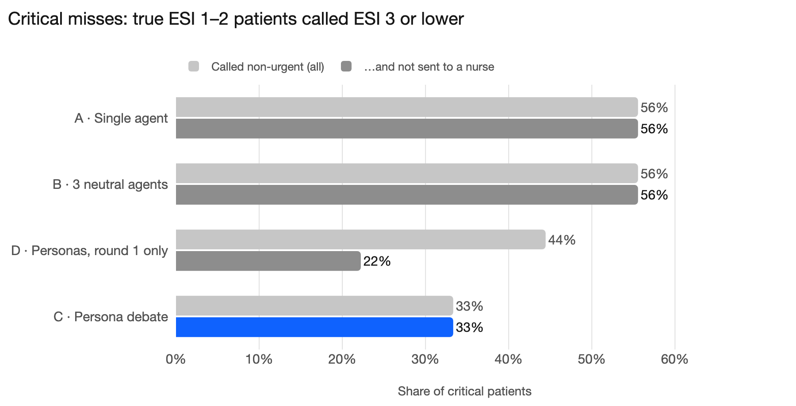

# PrioriHealth

A panel of ten small AI agents discusses emergency department triage (ESI) decisions until at least 9 of 10 agree. When they can't, or when an urgent dissent gets outvoted, the case goes to a human nurse. Built for the IBM Z Datathon and deployed on an IBM LinuxONE z17, with IBM Granite models running on the z17's on-chip AI accelerator.

> Decision-support prototype only. Not for clinical use. All hospitals in the demo are fictional.

## Results

Evaluated on a 20-patient sample of the [TriageAgent](https://github.com/Lucanyc/TriageAgent) benchmark with IBM Granite 3.3 (8B), comparing a single agent to the full ten-member panel:

| | Single agent | Ten-member panel |
|---|---|---|
| Exactly correct ESI level | 45% | 50% |
| Within one level | 85% | 90% |
| Critical patients (ESI 1–2) under-triaged | 56% | 44% |
| Critical patients under-triaged **and not sent to a nurse** | 56% | **22%** |
| Cases escalated to a nurse | 0% | 45% |
| LLM calls per patient | 1 | 11.4 |

**Main takeaway:** the panel's accuracy is only slightly better than a single agent's, but its escalation rule catches most of the dangerous mistakes. Critical patients who were under-triaged with no nurse review dropped from 56% to 22%. The cost is more compute and a higher nurse review load.

With n = 20 the confidence intervals are wide, so these numbers show direction, not a final result. The full 75-case run is supported (`--full`) but not reported here yet.



The experiment compares four conditions at the same model and prompt: (A) a single agent, (B) a panel of identical neutral agents discussing to consensus, (C) the ten-member trait panel discussing to consensus, and (D) the trait panel voting once with no discussion. Full numbers are in `results/ollama/sample/metrics.csv`.

## How it works

- **Panel:** Empath, Logician, Skeptic, Observer, Synthesizer, Pragmatist, Vigilant, Impartial, Mediator, Reflective. Each is a reasoning *style*. None leans toward more or less urgent levels, and all share one ESI v4 reference.
- **Discussion:** round 1 is independent. In later rounds each member reads everyone's position, replies to specific members by name, and may change its answer only for a named clinical reason. Discussion stops at 90% agreement or after 5 rounds.
- **Escalation:** a case goes to a nurse if the panel doesn't reach consensus, or if any member who called it ESI 1–2 is outvoted to ESI 3 or lower.
- **Waiting room:** live arrivals are triaged in the background and ordered by ESI-weighted wait. Each level has a target time to be seen (ESI 1 now, ESI 2 within 10 min, 3 within 30, 4 within 60, 5 within 120), and whoever is furthest past their target goes first.
- **Accounts:** public landing page, sign up / sign in, and a one-click demo account. Each user belongs to one of eight fictional hospitals, each with its own waiting room. Users and sessions are stored in SQLite with scrypt password hashes and HttpOnly session cookies.

## Running on IBM LinuxONE (z17)

The whole system (web app, Granite agents via llama.cpp, and experiments) runs on an IBM LinuxONE (s390x) server.

- **On-chip AI accelerator:** llama.cpp is built with IBM zDNN so Granite runs on the z17's Telum II AI accelerator (NNPA). On a 3-vCPU z17 VM, prompt processing went from about 21 tokens/s on the CPU to about 105 tokens/s on the accelerator, **roughly 5× faster**, with the same answers.
- Setup and service files are in [deploy/linuxone/](deploy/linuxone/DEPLOY.md).

```bash
bash deploy/linuxone/setup.sh && bash deploy/linuxone/install_services.sh
bash deploy/linuxone/build_zdnn.sh   # accelerator build (z17 / LinuxONE 5 only)
```

## Run locally

```bash
uv sync                                  # Python 3.11 + dependencies
cd web && npm install && npm run build   # build the web interface once
cd .. && uv run python scripts/serve.py  # http://localhost:8000
```

The app reads cached results from `results/`, so it works offline. "Triage new case" runs live on a free local engine: llama.cpp on LinuxONE, or Ollama on a Mac/PC. watsonx is disabled unless `llm.monthly_token_budget.watsonx` in `config.yaml` is raised.

## Online demo (Vercel)

https://priorihealth.miles-ehrlich.com runs in **showcase mode**: the recorded evaluation, case
review and debates, plus live triage of one case at a time on **IBM Granite 4.0 Micro via
Cloudflare Workers AI** (free tier: 10,000 neurons/day, about 30–40 cases). Sign-in is the demo
account only, and the waiting room is off (it needs an always-on server; use LinuxONE for that).

1. Import the repo in Vercel; `vercel.json` sets the build (web/dist) and the Python function (`api/index.py`).
2. Environment variables: `CLOUDFLARE_ACCOUNT_ID` and `CLOUDFLARE_API_TOKEN` (Cloudflare dashboard →
   API Tokens → template "Workers AI"). Optional: `PRIORIHEALTH_LIVE_PER_IP_DAY` (default 5).
3. Domains: add `priorihealth.miles-ehrlich.com`.

Locally, `PRIORIHEALTH_SHOWCASE=1 uv run python scripts/serve.py` runs the same mode, and
setting the two Cloudflare variables in `.env` adds Cloudflare as a live engine in the normal app.

## Reproduce the experiments

```bash
uv run python scripts/download_data.py                        # TriageAgent benchmark (pinned commit)
uv run python scripts/run_experiments.py --provider ollama    # 20-patient sample; add --full for all 75
uv run --extra charts python scripts/make_charts.py           # charts (needs Chrome)
uv run pytest
```

LLM responses are cached in `.cache/llm/` and committed on purpose, so the reported results can be reproduced exactly without rerunning the models. Credentials (watsonx only) go in `.env`; see `.env.example`.

## Repository layout

```
src/triage_debate/   agents, discussion protocol, escalation, metrics, API
scripts/             data download, experiments, charts, web server
web/                 React front end
deploy/linuxone/     LinuxONE setup, llama.cpp and zDNN builds, services
results/             cached experiment results and charts
tests/               unit tests (including checks that labels never leak into prompts)
video/               overview and demo video source
```

## Limitations

- Small evaluation sample (20 patients); results need the full 75-case run to confirm.
- The panel sends a large share of cases to a nurse, which trades review workload for safety.
- In a sex-swap fairness check, changing only the patient's sex changed 2 of 14 decisions for both the single agent and the panel, so bias needs more study before any real use.
- Benchmark vignettes are written cases, not live clinical data.

## License

MIT
